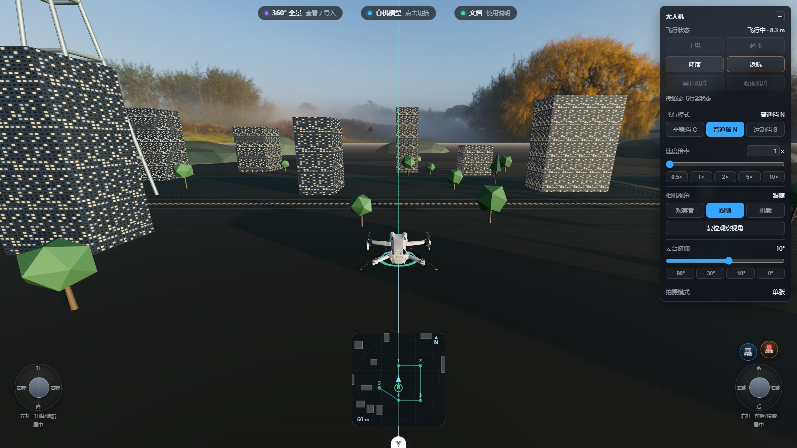
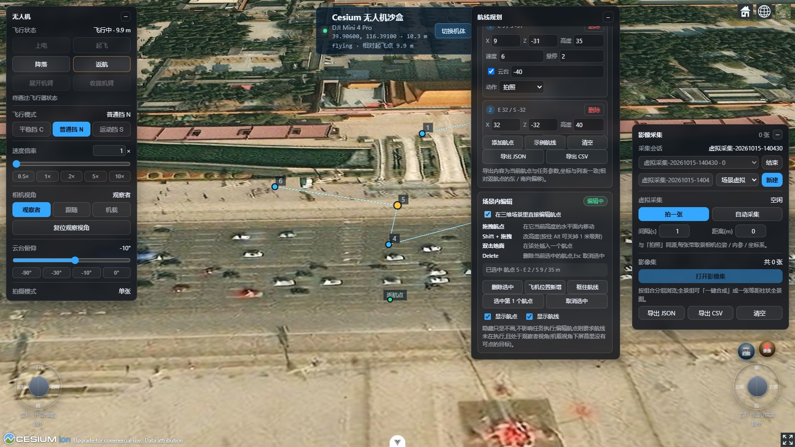

<div align="center">

# drone-camera

Recoverable capture Agent: [run a structured collection task, pause/resume, validate and export a COLMAP bundle](agent/README.md). [Callable tool inventory](agent/TOOLS.md).

**A framework-agnostic drone control library for the browser — one flight core, two renderers (three.js & CesiumJS).**

[](./LICENSE)
[](./tsconfig.lib.json)


**▶ [Live demo](https://chenlong2019.github.io/drone-camera/)** — three.js & CesiumJS backends, panorama, mission editing, all in the browser.

[中文文档](./README.zh-CN.md)

</div>

<table>
<tr>
<td width="50%"></td>
<td width="50%"></td>
</tr>
<tr>
<td align="center"><sub><b>three.js</b> — follow camera, flight panel, mini-map (local sandbox)</sub></td>
<td align="center"><sub><b>CesiumJS</b> — real-Earth coordinates (ENU/ECEF), in-scene waypoint editing</sub></td>
</tr>
</table>

## Why

Browser drone simulators exist. GIS drones on a 3D globe exist. **One flight core driving both — with a complete camera-to-panorama pipeline — does not.** drone-camera fills that gap:

- **One core, two renderers** — the same `DroneSim` flight-state machine (physics, battery, failsafes, geofence, obstacle AABB) drives a three.js WebGPU sandbox *and* a CesiumJS real-Earth backend. Switch backends with a single option; panels, mission editor and mini-map don't change.
- **Zero-dependency core** — `drone-sim` runs in Node or a Web Worker with no DOM, no three, no browser. Test your flight logic headlessly.
- **Complete imaging pipeline** — photo/video capture with camera intrinsics, automated panorama flights (wide / 180° / full 360°), pose-based stitching (no feature matching, no OpenCV), an equirectangular viewer, and a capture gallery with EXIF/GPS import for real photos.
- **AI-ready** — an MCP server exposes 14 `drone_*` tools so an AI agent can fly the drone, edit missions, and take photos. Headless driver included.
- **Framework-free UI** — panels are plain DOM (Vue/React/svelte/no-framework, all fine). The library itself imports nothing from any UI framework.

## Install

```sh
npm install drone-camera three
# TypeScript users:
npm install -D @types/three
```

> three.js is a **peer dependency** and stays external in ESM builds, so you never get two copies of three on one page. A UMD build with three bundled is also included (`index.umd.cjs`, exposes `window.DroneControl`).

## Quick start (three.js)

```ts
import * as THREE from 'three'
import { WebGPURenderer } from 'three/webgpu'
import { OrbitControls } from 'three/addons/controls/OrbitControls.js'
import { createDroneControl, DroneControlPanel } from 'drone-camera'

const scene = new THREE.Scene()
const camera = new THREE.PerspectiveCamera(60, innerWidth / innerHeight, 0.1, 4000)
const renderer = new WebGPURenderer({ antialias: true })
renderer.setSize(innerWidth, innerHeight)
document.body.appendChild(renderer.domElement)
const controls = new OrbitControls(camera, renderer.domElement)

// Assembles physics core + vehicle rig + gimbal + night LED lights + ranging radar.
// No modelUrl → built-in procedural quadcopter (zero assets required).
const drone = await createDroneControl({ engine: 'three', scene, camera, renderer, controls })

// Native DOM panel: arm/takeoff/land, sticks, flight modes, camera views, photo & video.
new DroneControlPanel(drone)

renderer.setAnimationLoop(() => {
  drone.animate()
  if (drone.isOrbitView) controls.update()
  drone.captureRecordingFrame()   // gimbal framing for photo/video, no-op otherwise
  drone.onBeforeRender()
  renderer.render(scene, camera)
  drone.onAfterRender()
})
```

Orbit around it, switch to FPV, gimbal it, take a photo — all from the panel. Keyboard flight is built in.

## Switch to CesiumJS (same code, real Earth)

```ts
import { createDroneControl, loadCesiumScript } from 'drone-camera'

await loadCesiumScript('/Cesium/Cesium.js')

// ENU/ECEF earth coordinates; origin altitude auto-sampled from terrain
const drone = await createDroneControl({ engine: 'cesium', viewer, lon: 116.391, lat: 39.906 })

// Same panels — new DroneControlPanel(drone) works unchanged.
```

## AMap / Gaode Map (JS API 2.0, the "second screen")

AMap ships its own rendering engine — it is **not a tile source**, so it cannot go into Cesium.
In this library it is a standalone China map that shares the same `DroneSim` truth as the
three.js / Cesium views and draws the drone / mission / trail on top:

```ts
import { AmapDroneMap } from 'drone-camera'

const map = new AmapDroneMap({
  container,                 // a sized div
  sim,                       // DroneSim (zero-dependency, runs without any renderer)
  origin: { longitude: 116.391, latitude: 39.906, altitude: 0 },
  key: import.meta.env.VITE_AMAP_KEY,
  securityCode: import.meta.env.VITE_AMAP_JSC0DE, // must pair with the key
})
await map.open()             // inject script → build map → overlays (satellite / roadnet / drone / mission / trail / home)
```

Two hard conventions:

- **Coordinates**: sim truth is WGS84 while AMap is GCJ-02 everywhere; without conversion the
  drone lands ~500 m off (the module outputs `frame: 'gcj'` by default and exports
  `wgs84ToGcj02` / `gcj02ToWgs84` / `gcj02OffsetMeters` — measured offset in Beijing ≈ 532 m east);
- **Security-code order**: `_AMapSecurityConfig` must be set **before** the script tag is
  injected, otherwise you get a silent `INVALID_USER_SCODE`. The loader handles it — don't
  hand-roll the injection.

The map opens in **3D mode** by default (adjustable pitch/rotation plus a 3D buildings layer).
`viewMode` is a constructor-only option in JS API 2.0 — it cannot be switched at runtime, so the
library always builds 3D and expresses "2D" as `pitch = 0`.

Demo: `/amap-demo` (keys via `VITE_AMAP_KEY` / `VITE_AMAP_JSC0DE`, see `.env.example`).

## Features

| | |
|---|---|
| ✈️ Flight core | State machine (disarmed → armed → takeoff → flight → RTH → land), battery model, failsafes, altitude/distance ceilings, obstacle AABB avoidance, event log |
| 🎮 Control | Stick normalization, keyboard control, motion/normal modes, speed & attitude limits |
| 🛰 Backends | `three` (WebGPU sandbox) and `cesium` (real Earth) behind one interface — `createDroneControl({ engine })` |
| 🧊 Vehicle | Procedural built-in quadcopter or any GLB; arms/props/gimbal driven by semantic node names; night LED lights; ranging radar |
| 📷 Capture | Photo & video with camera pose + intrinsics, gimbal framing, capture sessions |
| 🌏 Panorama | Auto flight patterns (wide 9-shot / 180° 21-shot / 360°), pose-based stitching to equirectangular, spherical WebGL viewer |
| 🗺 Missions | In-scene waypoint editing (drag / Shift-altitude / insert / delete), execution, JSON/CSV/Manifest export |
| 🖥 UI | Plain-DOM flight panel, mission panel, capture panel, mini-map, gallery popups — mount anywhere |
| 🤖 AI | MCP server with 14 tools + headless CLI driver for scripted/agent flights |
| 🔌 MAVLink / SITL | Drive the same scene from a **real flight stack** (PX4 / ArduPilot, real or SITL) over MAVLink 2 — telemetry in, commands out, zero changes to panels or renderers |

## Panorama in three lines

```ts
import { CaptureService, PanoramaCapture } from 'drone-camera'

const capture = new CaptureService({ provider: drone })   // drone = your engine host
const session = capture.createSession({ source: 'virtual-camera', name: 'Around the tower' })
const pano = new PanoramaCapture(capture)
await pano.start(session.id, 'pano-360')   // body spins for yaw, gimbal stacks pitch rows
```

Stitching exploits the fact that every shot's camera pose is known exactly — images are back-projected onto the equirectangular canvas, no feature matching or OpenCV involved.

## Two flight sources, one switch (built-in model ⇄ MAVLink / SITL)

Every scene has two interchangeable brains: the **built-in `DroneSim`** (zero dependencies, works offline) and a **real flight stack** (PX4 / ArduPilot, hardware or SITL) speaking MAVLink 2. Both take over the same `DroneSim` instance — not the renderer — so panels, mini-map, capture services and **both renderers (three.js and CesiumJS)** keep working unchanged:

```ts
import { FlightSourceManager } from 'drone-camera'

const sources = new FlightSourceManager({ sim: drone.sim, onChange: renderChip })

await sources.useMavlink('ws://127.0.0.1:8118')  // PX4 / ArduPilot takes over mid-flight
await sources.useInternal()                       // hand it back; mid-air handover keeps hovering
```

Switching is hot — no scene rebuild, no page reload. A failed connection automatically falls back to the built-in model, otherwise every panel button would be dispatched into a link that does not exist. Prefer the lower-level API? `MavlinkSource` (`attach` / `connect` / `close`) is what the manager drives internally.

Browsers cannot open UDP sockets, so a tiny zero-dependency bridge (UDP ⇄ WebSocket) ships in [`mavlink/`](mavlink/README.md):

```bash
node mavlink/bridge.mjs                 # UDP 14550 ⇄ ws://127.0.0.1:8118
make px4_sitl gz_x500                   # or: sim_vehicle.py -v ArduCopter
# open the demo with ?mavlink=ws://127.0.0.1:8118
```

No PX4 installed? `node mavlink/fake-sitl.mjs` speaks real MAVLink 2 (framing, CRC_EXTRA, mission handshake) so the whole loop can be verified without a flight stack. `fake-sitl.mjs` enforces **PX4's behaviour contract** rather than agreeing to everything: arming is asynchronous (an early `NAV_TAKEOFF` gets `COMMAND_DENIED`), OFFBOARD drops after 1 s without setpoints (`COM_OF_LOSS_T`), `MANUAL` without RC failsafes, and unanswered waypoint requests are retried then rejected. Conformance is checked by `npm run mavlink:verify`: CRC_EXTRA cross-check, codec units, the PX4 contract suite, and end-to-end runs over both modern and legacy mission handshakes.

## Export a COLMAP dataset (SfM / 3DGS hand-off)

Captured frames already carry exact poses, so the whole set can be written out as a standard COLMAP dataset — the format every reconstruction tool reads:

```ts
import { buildCaptureManifest, exportColmapDataset } from 'drone-camera'

const dataset = exportColmapDataset(buildCaptureManifest(session))
// dataset.camerasTxt / imagesTxt / points3Dtxt → write into reconstruction/<id>/colmap/
```

The output is byte-level COLMAP: `images.txt` puts **two lines per image** (the second one is empty when there are no 2D observations), `qvec` is world-to-camera in `[qw,qx,qy,qz]` order, and `tvec` is `-R·C` rather than the camera centre. Frames with different intrinsics (zoom, multi-camera rigs) automatically get their own `camera_id`. Re-projection is verified against three.js: poses parsed back out of the file land on the same pixels the renderer produced.

```bash
npm run colmap:export -- --manifest captures/<id>/manifest.json --out reconstruction/<id>/colmap
npm run colmap:export -- --sample --out /tmp/colmap-sample   # inspect the shape without data
```

`points3D.txt` is empty by default — let SfM triangulate it. Note that 3DGS-style trainers need those points to initialise Gaussians, so run the COLMAP mapper first or pass `points` explicitly.

### One shot: images + triple files in a single zip

The CLI above needs `manifest.json` and the images **on disk**, but in-browser captures live in memory (`imageUrl` is a data URL). `buildCaptureBundle` is the missing step — one call gives you a directory you can feed straight to `colmap feature_extractor`:

```ts
import { buildCaptureBundle, captureBundleFileName } from 'drone-camera'

const bundle = buildCaptureBundle({
  manifest: capture.buildManifest(session.id),
  images: session.images.map((image) => ({ id: image.id, dataUrl: image.imageUrl })),
})
// bundle.bytes  → save as captureBundleFileName(bundle.manifest)
// bundle.files  → what went in; bundle.missing → frames with no image data this time
```

The zip contains `manifest.json` + `cameras.txt` + `images.txt` + `points3D.txt` + `images/00001.png…`. Two details are deliberate:

- **The packer assigns the filenames and writes them back into the manifest's `file`.** `images.txt` takes its NAME column from that field; if the two drift apart COLMAP reports missing images while the triple files still look perfectly valid — silent and nasty. The bundle therefore holds an invariant: what the manifest lists is what the zip contains, and the triple files are generated from that manifest.
- **Store-only zip, no deflate.** PNG is already compressed; deflate buys a few percent and costs a compression implementation.

The demo's top-bar「导出 COLMAP」is exactly this: one click after a capture yields `<captureId>-colmap.zip` (measured: 74 frames at 1600×900 ≈ 88 MB).

### Real capture data → viewer

The chain closes on real data, not the built-in sample: the splat viewer loads **actual capture poses** (each image drawn as a frustum with its true position/orientation/FOV) and **actual COLMAP output**:

```ts
import { capturePosesToCloud, parseColmapDataset, colmapDatasetToCloud } from 'drone-camera'

capturePosesToCloud(session)                 // frustum skeleton from a live capture session
const cloud = colmapDatasetToCloud(
  parseColmapDataset({ camerasTxt, imagesTxt, points3Dtxt }),
)                                            // sparse points + frustums after `colmap mapper`
```

In the three.js demo the "Splat" chip opens the current capture session automatically. Two details this implementation refuses to get wrong:

- **`qvec` is world-to-camera** — the pose parser conjugates it *before* the axis conversion. Skipping the conjugate leaves every camera centre correct while tilting every frustum; a position-only test cannot catch it (verified by mutation testing).
- **ECEF capture poses are converted to ENU before display** — drawing 6.3e6-metre coordinates with float32 positions loses half a metre of precision before rendering even starts.

CLI, for the moment COLMAP has run on your machine:

```bash
npm run colmap:inspect -- --dir sparse/0 --out cloud.splat    # sparse model → draggable .splat
```

The script prints the cheap pre-training check: mean track length (below 2 means triangulation is not trustworthy) and mean reprojection error (above 1 px means calibration needs attention).

### Planning the capture itself

`drone-recon-capture` plans the flight pattern that produces those images. The key identity it is built on: **overlap ratio and baseline/depth ratio are the same constraint written twice** (`b/d ≈ fov·(1−o)` in the far field). Three patterns:

```ts
import { planReconCapture, ReconstructionCapture, reconCoverage } from 'drone-camera'

const plan = planReconCapture({ pattern: 'orbit', target: { center: [0, 0, 8], size: [20, 20, 16] } })
plan.baselineRatio          // 0.35 — inside the near-field usable band
plan.effectiveOverlap       // may exceed what you asked: b/d is the hard cap, overlap is the floor
const result = await new ReconstructionCapture(capture).start(session.id, plan)
result.coverage.usable      // 1.00 — surfaces seen from ≥3 views
result.coverageCloud        // heat-map point cloud: red = unseen, blue = ≥8 views
```

Details this implementation refuses to fudge:

- **Depth is measured to the surface, not the centre.** Orbiting a 20 m-wide building from 30 m gives a surface depth of 20 m, not 30 — using the centre would understate `b/d` by 50%. This is exactly why close-range orbits need higher overlap than aerial survey.
- **The step angle obeys two constraints and takes the tighter one.** Overlap sets a floor density; `b/d ≤ 0.6` is the hard cap where cross-view matching breaks. Near-field orbits usually hit the cap first, which is the quantified reason "shoot closer things denser".
- **Back-face culling in the coverage stats.** Without it, orbiting a convex body makes every surface point visible from every shot and the report reads 100% forever. The down-facing face is excluded by default (aerial rigs never see it).
- **`placeBodyAt` is teleport, honestly labelled.** In simulation there is no reason to actually fly ten minutes to generate training data; poses stay ground-truth. For real aircraft the same plan exports as waypoints (`reconPlanToWaypoints`).

In the three.js demo the "重建采集" chip runs a 2-ring orbit around the block under the drone and opens the heat map when done.

### Autonomous oblique survey for a rectangular site

`drone-survey` converts a site rectangle into a dispatchable mission and waits for the body heading to settle before each capture:

```ts
import { CaptureService, ObliqueSurveyRunner, planObliqueSurvey } from 'drone-camera'

const plan = planObliqueSurvey({
  area: { center: [36, 30], size: [160, 136] }, // Three.js world x/z
  targetHeight: 0, // sample the ground, not building volumes
  altitude: 35,
  tiltDeg: 38,
})
const runner = new ObliqueSurveyRunner(drone, capture)
runner.load(plan)
runner.start(session.id)

// Render loop: drone.animate() → runner.update() → render
```

`/digital-campus-demo` is the complete example: the central lawn and adjacent internal roads, flight panel, waypoint list, ground point-cloud PLY export and capture manifest over the same pipeline.

## 3D Gaussian Splatting viewer

The third representation, next to meshes and point clouds: each splat is an oriented ellipsoid with an opacity, alpha-blended back-to-front. The viewer is dependency-free WebGL2 (same discipline as the panorama viewer), driven by a `SplatCloud` parsed from a 3DGS `.ply`, an antimatter15 `.splat`, or a plain point-cloud `.ply` (downgraded to isotropic spheres):

```ts
import { DroneSplatViewer, createReconstructionSample, parseSplat } from 'drone-camera'

const viewer = new DroneSplatViewer()
viewer.open()                                  // built-in sample scene, zero assets
viewer.loadBuffer(await file.arrayBuffer(), file.name)   // or drop a .ply / .splat onto the stage
```

What the implementation gets right (each verified by unit tests or the end-to-end script):

- **EWA projection** — the 3D covariance is squashed by the perspective Jacobian into a 2D ellipse whose axes come from an eigendecomposition; the 0.3 px² low-pass term keeps distant splats from flickering below one pixel.
- **Per-frame radix sort** — alpha blending is not commutative, so splats are sorted far-to-front every frame with a two-pass 16-bit LSD radix sort (O(2n), ~2 ms for 50k); only the sorted **index** buffer is re-uploaded, attribute data lives in float textures fetched by `texelFetch`.
- **Honest degradation** — higher-order spherical harmonics are dropped (DC-only colour) and the HUD says so; log-scale / logit-opacity / SH-DC encodings are all decoded on input.

In the three.js demo, the toolbar chip opens it: `three-demo` → "Splat".

## Documentation

Full API reference, generated from the library's own `.d.ts`:

- `docs/` route in the demo app — usage guide
- `api-docs/` route — **1088 documented members** across 24 modules
- `class-map/` route — interactive architecture map (Vue Flow)

## Demo

```sh
npm install
npm run dev          # → /three-demo  /digital-campus-demo  /cesium-demo  /docs  /api-docs
```

## AI agent mode (MCP)

The repo ships `mcp/drone-mcp-server.mjs` — a stdio MCP server exposing the running demo to an AI agent: take off, fly waypoints, edit missions, gimbal, shoot panoramas, read radar, screenshot. Wire it into any MCP client and let the model fly.

## Architecture

```
┌───────────────────────── UI (plain DOM, framework-free) ─────────────────────────┐
│   DroneControlPanel  MissionPanel      CapturePanel       MiniMap   Gallery   │
└──────────────────────────────────────┬───────────────────────────────────────────┘
                                       │ host interfaces (not inheritance)
┌──────────────────────────────────────┴───────────────────────────────────────────┐
│              createDroneControl({ engine: 'three' | 'cesium' })                   │
├──────────────────────────────┬────────────────────────────────────────────────────┤
│  DroneFly (three.js/WebGPU)  │  CesiumDroneAdapter (ENU/ECEF real Earth)           │
├──────────────────────────────┴────────────────────────────────────────────────────┤
│  DroneSim — zero-dependency flight core (Node / Worker / browser)                 │
└───────────────────────────────────────────────────────────────────────────────────┘
```

## License

[MIT](./LICENSE)
