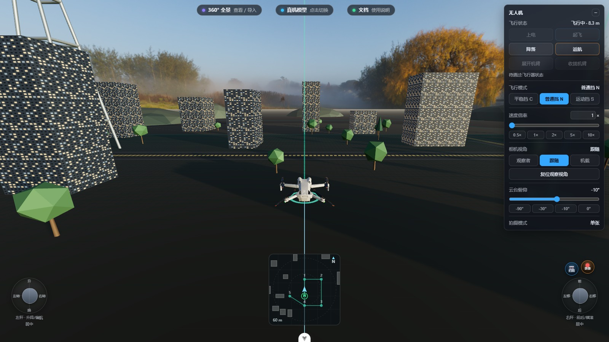
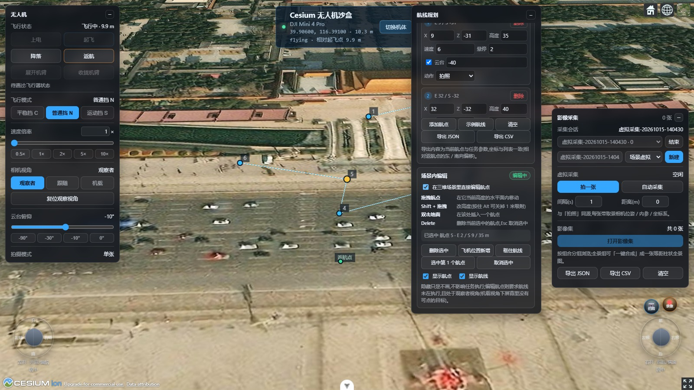

<div align="center">

# drone-camera

**与框架无关的浏览器无人机控制系统库 —— 同一套飞控内核，双渲染后端（three.js & CesiumJS）。**

[](./LICENSE)

[English](./README.md)

</div>

<table>
<tr>
<td width="50%"></td>
<td width="50%"></td>
</tr>
<tr>
<td align="center"><sub><b>three.js</b> —— 跟随视角、飞控面板、鹰眼图(本地沙盒)</sub></td>
<td align="center"><sub><b>CesiumJS</b> —— 地球坐标系(ENU/ECEF),场景内拖拽编辑航点</sub></td>
</tr>
</table>

## 为什么做这个

浏览器里的无人机模拟器有,GIS 地球上飞的无人机也有。**同一套飞控内核同时驱动两者、并带完整影像链路的,目前没有。** drone-camera 补的就是这个位置:

- **一套内核,两个后端** —— 同一个 `DroneSim` 飞行状态机(物理、电池、失效保护、限高限距、AABB 避障)既驱动 three.js WebGPU 沙盒,也驱动 CesiumJS 真实地球后端。换后端只改一个参数,面板 / 航线编辑 / 鹰眼图全部不用动。
- **零依赖内核** —— `drone-sim` 不碰 DOM、不引 three,Node / Web Worker 里裸跑。飞控逻辑可以无头测试。
- **完整影像链路** —— 带相机位姿与内参的拍照/录像、自动全景飞行(广角 / 180° / 球形 360°)、按位姿反投影的拼接(不需要特征匹配,不需要 OpenCV)、等距柱状查看器、影像集弹窗,还支持真实照片的 EXIF/GPS 导入。
- **AI 可指挥** —— 内置 MCP Server,14 个 `drone_*` 工具,AI Agent 能直接起飞、飞航线、拍全景、读雷达。附带无头驱动。
- **UI 与框架无关** —— 面板全部是原生 DOM(Vue / React / 无框架都能挂),库本身不 import 任何 UI 框架。

## 安装

```sh
npm install drone-camera three
# TypeScript 用户:
npm install -D @types/three
```

> three.js 是 **peerDependency**,ESM 构建里保持 external,同一页面不会出现两份 three 实例。另附 three 已内联的 UMD 构建(`index.umd.cjs`,暴露全局 `window.DroneControl`)。

## 快速开始(three.js)

```ts
import * as THREE from 'three'
import { WebGPURenderer } from 'three/webgpu'
import { OrbitControls } from 'three/addons/controls/OrbitControls.js'
import { createDroneControl, DronePanel } from 'drone-camera'

const scene = new THREE.Scene()
const camera = new THREE.PerspectiveCamera(60, innerWidth / innerHeight, 0.1, 4000)
const renderer = new WebGPURenderer({ antialias: true })
renderer.setSize(innerWidth, innerHeight)
document.body.appendChild(renderer.domElement)
const controls = new OrbitControls(camera, renderer.domElement)

// 一次装配:物理内核 + 机体 + 云台 + 夜航灯 + 测距雷达。
// 不传 modelUrl → 内置程序化四轴(零资产依赖)。
const drone = await createDroneControl({ engine: 'three', scene, camera, renderer, controls })

// 原生 DOM 面板:上电/起飞/降落、摇杆、飞行模式、视角切换、拍照/录像。
new DronePanel(drone)

renderer.setAnimationLoop(() => {
  drone.animate()
  if (drone.isOrbitView) controls.update()
  drone.captureRecordingFrame()   // 拍照/录像取景钩子,不拍时零开销
  drone.onBeforeRender()
  renderer.render(scene, camera)
  drone.onAfterRender()
})
```

轨道环视、机载 FPV、云台、拍照 —— 面板里全部可用,键盘飞行内置。

## 切到 CesiumJS(同样的代码,真实的地球)

```ts
import { createDroneControl, loadCesiumScript } from 'drone-camera'

await loadCesiumScript('/Cesium/Cesium.js')

// ENU/ECEF 地球坐标;锚点海拔自动采样地形
const drone = await createDroneControl({ engine: 'cesium', viewer, lon: 116.391, lat: 39.906 })

// 同一套面板 —— DronePanel(drone) 一字不改。
```

## 功能

| | |
|---|---|
| ✈️ 飞控内核 | 状态机(未上电→上电→起飞→飞行→返航→降落)、电池模型、失效保护、限高限距、AABB 避障、事件日志 |
| 🎮 操控 | 摇杆归一化、键盘控制、运动/普通模式、速度与姿态限幅 |
| 🛰 双后端 | `three`(WebGPU 沙盒)与 `cesium`(真实地球),一个接口之后 —— `createDroneControl({ engine })` |
| 🧊 机体 | 内置程序化四轴或任意 GLB;机臂/桨叶/云台按语义节点名驱动;夜航灯;测距雷达 |
| 📷 采集 | 拍照/录像带相机位姿与内参、云台取景、采集会话 |
| 🌏 全景 | 自动拍摄(广角 9 张 / 180° 21 张 / 球形 360°)、按位姿反投影拼接、球面 WebGL 查看器 |
| 🗺 航线 | 场景内拖拽编辑(拖动 / Shift 改高 / 插入 / 删除)、任务执行、JSON/CSV/Manifest 导出 |
| 🖥 UI | 原生 DOM 飞控面板、航线面板、采集面板、鹰眼图、影像集弹窗 —— 到处都能挂 |
| 🤖 AI | MCP Server(14 个工具) + 无头 CLI 驱动,脚本化 / Agent 飞行 |

## 全景三行接入

```ts
import { DronePanorama } from 'drone-camera'

const pano = new DronePanorama(drone, { mode: 'sphere' }) // 机体自转补水平视野,云台做俯仰分层
await pano.start()   // → 影像入集 → 一键合成 → 球面环视
```

拼接利用了这条链路的免费红利:**每张照片的取景位姿是精确已知的**,直接反投影到等距柱状画布即可 —— 不需要特征匹配,也不需要 OpenCV。

## 文档

以下 API 参考由库自身的 `.d.ts` 生成:

- demo 站 `docs/` 路由 —— 使用文档
- `api-docs/` 路由 —— **24 个模块、1088 个成员**的 API 参考
- `class-map/` 路由 —— 交互式架构图(Vue Flow)

## 运行 Demo

```sh
npm install
npm run dev          # → /three-demo  /cesium-demo  /docs  /api-docs
```

## AI Agent 模式(MCP)

仓库自带 `mcp/drone-mcp-server.mjs` —— 一个 stdio MCP Server,把运行中的 demo 暴露给 AI Agent:起飞、飞航点、编辑航线、云台、拍全景、读雷达、截图。接进任意 MCP 客户端,让模型自己飞。

## 架构

```
┌───────────────────────── UI(原生 DOM,与框架无关)─────────────────────────────┐
│   DronePanel        MissionPanel        CapturePanel       MiniMap   Gallery │
└──────────────────────────────────────┬────────────────────────────────────────┘
                                       │ 宿主接口(组合,非继承)
┌──────────────────────────────────────┴────────────────────────────────────────┐
│              createDroneControl({ engine: 'three' | 'cesium' })                │
├──────────────────────────────┬─────────────────────────────────────────────────┤
│  DroneFly (three.js/WebGPU)  │  CesiumDroneAdapter (ENU/ECEF 真实地球)          │
├──────────────────────────────┴─────────────────────────────────────────────────┤
│  DroneSim —— 零依赖飞控内核(Node / Worker / 浏览器通吃)                        │
└────────────────────────────────────────────────────────────────────────────────┘
```

## License

[MIT](./LICENSE)
