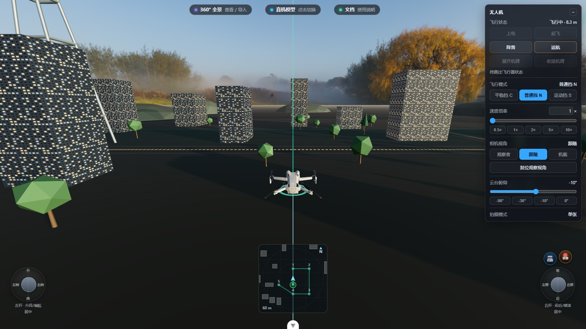
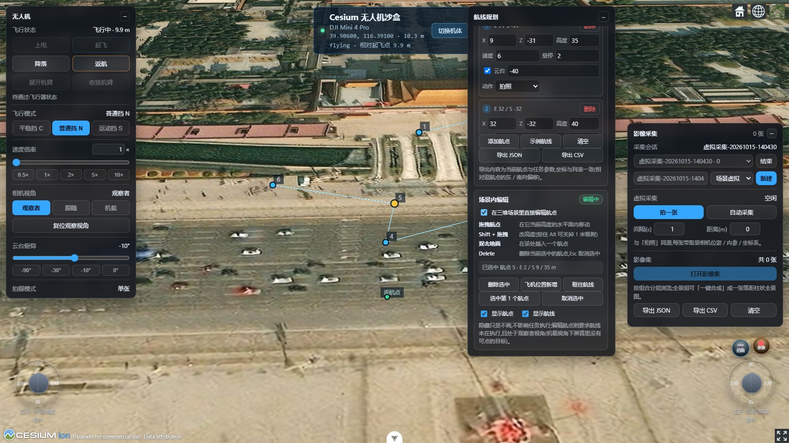

<div align="center">

# drone-camera

新增：[可恢复的采集 Agent](agent/README.md) · [可调用工具盘点](agent/TOOLS.md)。支持结构化计划、暂停恢复、数据校验与 COLMAP 数据包导出。

**与框架无关的浏览器无人机控制系统库 —— 同一套飞控内核，双渲染后端（three.js & CesiumJS）。**

[](./LICENSE)

**▶ [在线 Demo](https://chenlong2019.github.io/drone-camera/)** —— three.js 与 CesiumJS 双后端、全景、航线编辑,浏览器里直接体验。

[English](./README.md)

</div>

<table>
<tr>
<td width="50%"></td>
<td width="50%"></td>
</tr>
<tr>
<td align="center"><sub><b>three.js</b> —— 跟随视角、飞控面板、鹰眼图(本地沙盒)</sub></td>
<td align="center"><sub><b>CesiumJS</b> —— 地球坐标系(ENU/ECEF),场景内拖拽编辑航点</sub></td>
</tr>
</table>

## 为什么做这个

浏览器里的无人机模拟器有,GIS 地球上飞的无人机也有。**同一套飞控内核同时驱动两者、并带完整影像链路的,目前没有。** drone-camera 补的就是这个位置:

- **一套内核,两个后端** —— 同一个 `DroneSim` 飞行状态机(物理、电池、失效保护、限高限距、AABB 避障)既驱动 three.js WebGPU 沙盒,也驱动 CesiumJS 真实地球后端。换后端只改一个参数,面板 / 航线编辑 / 鹰眼图全部不用动。
- **零依赖内核** —— `drone-sim` 不碰 DOM、不引 three,Node / Web Worker 里裸跑。飞控逻辑可以无头测试。
- **完整影像链路** —— 带相机位姿与内参的拍照/录像、自动全景飞行(广角 / 180° / 球形 360°)、按位姿反投影的拼接(不需要特征匹配,不需要 OpenCV)、等距柱状查看器、影像集弹窗,还支持真实照片的 EXIF/GPS 导入。
- **AI 可指挥** —— 内置 MCP Server,14 个 `drone_*` 工具,AI Agent 能直接起飞、飞航线、拍全景、读雷达。附带无头驱动。
- **UI 与框架无关** —— 面板全部是原生 DOM(Vue / React / 无框架都能挂),库本身不 import 任何 UI 框架。

## 安装

```sh
npm install drone-camera three
# TypeScript 用户:
npm install -D @types/three
```

> three.js 是 **peerDependency**,ESM 构建里保持 external,同一页面不会出现两份 three 实例。另附 three 已内联的 UMD 构建(`index.umd.cjs`,暴露全局 `window.DroneControl`)。

## 快速开始(three.js)

```ts
import * as THREE from 'three'
import { WebGPURenderer } from 'three/webgpu'
import { OrbitControls } from 'three/addons/controls/OrbitControls.js'
import { createDroneControl, DroneControlPanel } from 'drone-camera'

const scene = new THREE.Scene()
const camera = new THREE.PerspectiveCamera(60, innerWidth / innerHeight, 0.1, 4000)
const renderer = new WebGPURenderer({ antialias: true })
renderer.setSize(innerWidth, innerHeight)
document.body.appendChild(renderer.domElement)
const controls = new OrbitControls(camera, renderer.domElement)

// 一次装配:物理内核 + 机体 + 云台 + 夜航灯 + 测距雷达。
// 不传 modelUrl → 内置程序化四轴(零资产依赖)。
const drone = await createDroneControl({ engine: 'three', scene, camera, renderer, controls })

// 原生 DOM 面板:上电/起飞/降落、摇杆、飞行模式、视角切换、拍照/录像。
new DroneControlPanel(drone)

renderer.setAnimationLoop(() => {
  drone.animate()
  if (drone.isOrbitView) controls.update()
  drone.captureRecordingFrame()   // 拍照/录像取景钩子,不拍时零开销
  drone.onBeforeRender()
  renderer.render(scene, camera)
  drone.onAfterRender()
})
```

轨道环视、机载 FPV、云台、拍照 —— 面板里全部可用,键盘飞行内置。

## 切到 CesiumJS(同样的代码,真实的地球)

```ts
import { createDroneControl, loadCesiumScript } from 'drone-camera'

await loadCesiumScript('/Cesium/Cesium.js')

// ENU/ECEF 地球坐标;锚点海拔自动采样地形
const drone = await createDroneControl({ engine: 'cesium', viewer, lon: 116.391, lat: 39.906 })

// 同一套面板 —— new DroneControlPanel(drone) 一字不改。
```

## 高德地图(JS API 2.0,「第二块屏」)

AMap 自带渲染引擎,**不是瓦片源**,塞不进 Cesium;它在库里的定位是一块独立的中国地图,
与 three / Cesium 共享同一份 `DroneSim` 真值画机体 / 航线 / 航迹:

```ts
import { AmapDroneMap } from 'drone-camera'

const map = new AmapDroneMap({
  container,                 // 一个有尺寸的 div
  sim,                       // DroneSim(零依赖,可以不带任何渲染器独立跑)
  origin: { longitude: 116.391, latitude: 39.906, altitude: 0 },
  key: import.meta.env.VITE_AMAP_KEY,
  securityCode: import.meta.env.VITE_AMAP_JSC0DE, // 必须与 key 配套
})
await map.open()             // 注入脚本 → 建图 → 铺覆盖物(卫星/路网/机体/航线/航迹/返航点)
```

两个硬约定:

- **坐标系**:sim 是 WGS84 真值,高德全域是 GCJ-02(火星坐标),不转换会整体偏 ~500m
  (模块默认按 `frame: 'gcj'` 输出,并导出 `wgs84ToGcj02` / `gcj02ToWgs84` / `gcj02OffsetMeters`
  供诊断 —— 北京实测偏移东 ~532m);
- **安全密钥顺序**:`_AMapSecurityConfig` 必须在脚本注入**之前**写好,晚一步是 `INVALID_USER_SCODE`,
  且不抛异常。loader 已处理,但别自己手写注入。

默认就是 **3D 视角**(倾角/旋转随时可调,还叠了 3D 建筑体块层)。注意 `viewMode` 是建图参数、
2.0 不支持运行期切换,所以库里默认开 3D、用 `pitch = 0` 表达 2D 俯视。

demo:`/amap-demo`(key 走 `VITE_AMAP_KEY` / `VITE_AMAP_JSC0DE`,见 `.env.example`)。

## 功能

| | |
|---|---|
| ✈️ 飞控内核 | 状态机(未上电→上电→起飞→飞行→返航→降落)、电池模型、失效保护、限高限距、AABB 避障、事件日志 |
| 🎮 操控 | 摇杆归一化、键盘控制、运动/普通模式、速度与姿态限幅 |
| 🛰 双后端 | `three`(WebGPU 沙盒)与 `cesium`(真实地球),一个接口之后 —— `createDroneControl({ engine })` |
| 🧊 机体 | 内置程序化四轴或任意 GLB;机臂/桨叶/云台按语义节点名驱动;夜航灯;测距雷达 |
| 📷 采集 | 拍照/录像带相机位姿与内参、云台取景、采集会话 |
| 🌏 全景 | 自动拍摄(广角 9 张 / 180° 21 张 / 球形 360°)、按位姿反投影拼接、球面 WebGL 查看器 |
| 🗺 航线 | 场景内拖拽编辑(拖动 / Shift 改高 / 插入 / 删除)、任务执行、JSON/CSV/Manifest 导出 |
| 🖥 UI | 原生 DOM 飞控面板、航线面板、采集面板、鹰眼图、影像集弹窗 —— 到处都能挂 |
| 🤖 AI | MCP Server(14 个工具) + 无头 CLI 驱动,脚本化 / Agent 飞行 |

## 全景三行接入

```ts
import { CaptureService, PanoramaCapture } from 'drone-camera'

const capture = new CaptureService({ provider: drone })   // drone = 你的引擎实例
const session = capture.createSession({ source: 'virtual-camera', name: '绕塔一圈' })
const pano = new PanoramaCapture(capture)
await pano.start(session.id, 'pano-360')   // 机体自转补水平视野,云台做俯仰分层
```

拼接利用了这条链路的免费红利:**每张照片的取景位姿是精确已知的**,直接反投影到等距柱状画布即可 —— 不需要特征匹配,也不需要 OpenCV。

## 两套飞控源,一个开关(内置模型 ⇄ MAVLink / SITL)

每个场景都有两个可互换的"大脑":**内置 `DroneSim`**(零依赖,离线可用)与**真飞控**
(PX4 / ArduPilot,真机或 SITL,说 MAVLink 2)。两者接管的都是同一个 `DroneSim` 实例而不是渲染器,
所以面板、鹰眼图、采集服务以及**两个渲染后端(three.js 与 CesiumJS)全程无感**:

```ts
import { FlightSourceManager } from 'drone-camera'

const sources = new FlightSourceManager({ sim: drone.sim, onChange: renderChip })

await sources.useMavlink('ws://127.0.0.1:8118')  // 飞行中 PX4 / ArduPilot 接管
await sources.useInternal()                       // 交还内置模型;空中交接会保持悬停
```

切换是热切换 —— 不重建场景、不刷新页面。连接失败会自动回退内置模型,
否则面板上所有按钮都会被派发给一条不存在的链路。想用更底层的 API?
`MavlinkSource`(`attach` / `connect` / `close`)就是管理器内部驱动的那一层。

浏览器开不了 UDP,所以带了一个零依赖小网桥(UDP ⇄ WebSocket),见 [`mavlink/README.md`](mavlink/README.md):

```bash
node mavlink/bridge.mjs                 # UDP 14550 ⇄ ws://127.0.0.1:8118
make px4_sitl gz_x500                   # 或:sim_vehicle.py -v ArduCopter
# demo 地址加 ?mavlink=ws://127.0.0.1:8118
```

没装 PX4?`node mavlink/fake-sitl.mjs` 说的是真实 MAVLink 2(帧结构、CRC_EXTRA、航线上传握手),
整条链路不需要飞栈就能验证。`fake-sitl.mjs` 不只会说 MAVLink 2,还**按 PX4 的行为契约拒绝非法请求**:解锁是异步的(抢先的起飞会被
`COMMAND_DENIED` 打回)、OFFBOARD 断流 1 秒就掉(`COM_OF_LOSS_T`)、无 RC 切 MANUAL 会 failsafe、
航点索要 3 次无应答就拒收整条航线。协议一致性由 `npm run mavlink:verify` 保证:CRC_EXTRA 交叉校验、
编解码单测、PX4 契约套件,以及现代/老式两种航线上传握手下的端到端验证。

## 导出 COLMAP 数据集(交给 SfM / 3DGS)

采集到的每一帧都带精确位姿,所以整套数据可以直接写成标准 COLMAP 数据集 —— 重建工具认的就是这个格式:

```ts
import { buildCaptureManifest, exportColmapDataset } from 'drone-camera'

const dataset = exportColmapDataset(buildCaptureManifest(session))
// dataset.camerasTxt / imagesTxt / points3Dtxt → 写进 reconstruction/<id>/colmap/
```

输出是字节级的 COLMAP:`images.txt` 里**每张图占两行**(没有 2D 观测时第二行留空),`qvec` 是
world-to-camera 且按 `[qw,qx,qy,qz]` 排列,`tvec` 是 `-R·C` 而不是相机中心。内参不同的帧
(变焦、多机)会自动分配各自的 `camera_id`。重投影正确性对着 three.js 验证:从文件里读回来的位姿,
投出的像素和渲染器当初画的位置一致。

```bash
npm run colmap:export -- --manifest captures/<id>/manifest.json --out reconstruction/<id>/colmap
npm run colmap:export -- --sample --out /tmp/colmap-sample   # 没有数据也能看产物形状
```

`points3D.txt` 默认为空,交给 SfM 自己三角化。注意 3DGS 那类训练器要靠这些点做高斯初始化,
所以要么先跑一遍 COLMAP mapper,要么显式传入 `points`。

### 一站式:影像 + 三件套打成一个 zip

上面的 CLI 要求磁盘上先有 `manifest.json` 和图片,而浏览器里的采集结果全在内存
(`imageUrl` 就是 data URL)。`buildCaptureBundle` 补的就是这一步 —— 一次打包,
解压出来就是一个能直接跑 `colmap feature_extractor` 的目录:

```ts
import { buildCaptureBundle, captureBundleFileName } from 'drone-camera'

const bundle = buildCaptureBundle({
  manifest: capture.buildManifest(session.id),
  images: session.images.map((image) => ({ id: image.id, dataUrl: image.imageUrl })),
})
// bundle.bytes  → 存成 captureBundleFileName(bundle.manifest)
// bundle.files  → 包内清单;bundle.missing → 这次没拿到影像数据的图
```

包里是 `manifest.json` + `cameras.txt` + `images.txt` + `points3D.txt` + `images/00001.png…`。
两处细节是刻意的:

- **文件名由打包器统一分配,并回写 manifest 的 `file`**。`images.txt` 的 NAME 直接取这个字段,
  两边不同源的后果是 COLMAP 报"图片不存在",而三件套本身看起来完全正常 —— 静默且难查。
  包因此满足一条不变量:清单列的图 = 包里有的文件,且三件套由这份清单生成。
- **ZIP 只做 store 不压缩**。PNG 已经压过,deflate 省不下几个点,却要多带一个压缩实现。

three demo 页顶的「导出 COLMAP」走的就是它:采完点一下,拿到 `<captureId>-colmap.zip`
(实测 74 张 1600×900 PNG ≈ 88 MB)。

### 真采集数据 → 查看器

这条链在**真数据**上闭合,而不是内置示例:Splat 查看器可以直接载入
**真实采集的位姿**(每张影像画成一个视锥,位置/朝向/视场角都是拍摄时的真值)
和 **COLMAP 的真实输出**:

```ts
import { capturePosesToCloud, parseColmapDataset, colmapDatasetToCloud } from 'drone-camera'

capturePosesToCloud(session)                 // 采集会话 → 视锥骨架
const cloud = colmapDatasetToCloud(
  parseColmapDataset({ camerasTxt, imagesTxt, points3Dtxt }),
)                                            // colmap mapper 跑完 → sparse 点 + 视锥
```

three demo 页顶的「Splat 重建」会优先用当前采集会话。两个实现上不肯将就的细节:

- **`qvec` 是 world→camera** —— 位姿解析先取共轭再做轴向转换。漏掉共轭,相机中心
  全部正确、视锥全部歪斜,只查位置的测试抓不到它(变异测试验证过)。
- **ECEF 位姿先换到 ENU 再显示** —— 用 float32 画 6.3e6 米的坐标,还没开始渲染
  精度就已经掉了半米。

COLMAP 跑完之后还有一条命令:

```bash
npm run colmap:inspect -- --dir sparse/0 --out cloud.splat    # sparse 模型 → 可拖入查看器的 .splat
```

脚本会打印训练前的廉价体检:平均 track 长度(小于 2 说明三角化不可信)和
平均重投影误差(大于 1px 该查标定)。

### 采集轨迹本身也可以规划

`drone-recon-capture` 负责规划"拍出这些图"的航线。它建立在一个恒等式上:
**重叠率与基线/景深比是同一条约束的两种写法**(远景下 `b/d ≈ fov·(1−o)`)。三种轨迹:

```ts
import { planReconCapture, ReconstructionCapture, reconCoverage } from 'drone-camera'

const plan = planReconCapture({ pattern: 'orbit', target: { center: [0, 0, 8], size: [20, 20, 16] } })
plan.baselineRatio          // 0.35 —— 落在近景可用区间
plan.effectiveOverlap       // 可能高于你设的值:b/d 是硬上限,重叠率只是下限密度
const result = await new ReconstructionCapture(capture).start(session.id, plan)
result.coverage.usable      // 1.00 —— 被 ≥3 个视角看到的表面占比
result.coverageCloud        // 覆盖热力图:红 = 没拍到,蓝 = ≥8 个视角
```

几处不肯将就的实现细节:

- **景深按主体表面算,不按中心算**。贴着 20 m 宽的楼在 30 m 处绕飞,到表面的距离是
  20 m 而不是 30 m —— 按中心算会把 b/d 低估一半。这正是"近景环绕要比航测更大重叠率"
  的定量来源。
- **角步进受两条约束,取更严的那条**。重叠率给下限密度;`b/d ≤ 0.6` 是跨视角匹配
  开始崩溃的硬上限。近景环绕通常先撞硬上限 —— 这就是"拍近处要更密"的量化解释,
  不是经验值。
- **覆盖统计带背面剔除**。没有它,凸体的每个表面点都会被每个拍点"看到",
  报告永远 100%,等于没统计。朝下的面默认不计(航拍拍不到物体底面)。
- **`placeBodyAt` 是瞬移,而且明说**。仿真里没有理由为了生成训练数据真飞十分钟,
  位姿依然是真值;真机则用 `reconPlanToWaypoints` 把同一份规划导出成航点真飞。

three demo 页顶的「重建采集」会绕机体正下方的场景块拍 2 圈,完成后自动打开覆盖热力图。

### 矩形测区的自主倾斜航线

`drone-survey` 把测区转换成可下发的航线,并在每个测绘点等待机体转向到位后再采集:

```ts
import { CaptureService, ObliqueSurveyRunner, planObliqueSurvey } from 'drone-camera'

const plan = planObliqueSurvey({
  area: { center: [36, 30], size: [160, 136] }, // Three.js 世界坐标 x/z
  targetHeight: 0, // 只采样地面，不按建筑体量规划
  altitude: 35,
  tiltDeg: 38,
})
const runner = new ObliqueSurveyRunner(drone, capture)
runner.load(plan)
runner.start(session.id)

// 渲染循环里:drone.animate() → runner.update() → render
```

`/digital-campus-demo` 是完整示例:中央草坪与相邻内环路、飞控面板、航点列表、地面
点云 PLY 导出和影像 manifest 共用同一条链路。

## 3D Gaussian Splatting 查看器

网格和点云之外的第三种表达:每个 splat 是一个带朝向的椭球加不透明度,从远到近做 alpha 混合。
查看器是零依赖 WebGL2(与全景查看器同一纪律),数据来自 `SplatCloud` —— 可由 3DGS 的 `.ply`、
antimatter15 的 `.splat` 或普通点云 `.ply`(降级成各向同性小球)解析:

```ts
import { DroneSplatViewer, createReconstructionSample, parseSplat } from 'drone-camera'

const viewer = new DroneSplatViewer()
viewer.open()                                  // 内置示例场景,零资产
viewer.loadBuffer(await file.arrayBuffer(), file.name)   // 或把 .ply / .splat 拖进弹窗
```

实现里三件值得较真的事(各有单测或端到端脚本背书):

- **EWA 投影** —— 三维协方差被透视雅可比压成 2D 椭圆,长短轴来自特征分解;0.3 px² 低通项
  防止远处 splat 小于一像素时闪烁。
- **每帧基数排序** —— alpha 混合不可交换,必须从远到近画;两轮 16 位 LSD 基数排序
  (O(2n),5 万条约 2ms),每帧只重传排好的**下标**,属性数据躺在 float 纹理里按 `texelFetch` 取。
- **诚实的降级** —— 高阶球谐被丢弃(只渲染 DC 基础色)且 HUD 明说;log 尺度 / logit 不透明度 /
  球谐 DC 三种编码都在读入时还原。

three demo 页顶工具条的「Splat」chip 打开它。

## 文档

以下 API 参考由库自身的 `.d.ts` 生成:

- demo 站 `docs/` 路由 —— 使用文档
- `api-docs/` 路由 —— **24 个模块、1088 个成员**的 API 参考
- `class-map/` 路由 —— 交互式架构图(Vue Flow)

## 运行 Demo

```sh
npm install
npm run dev          # → /three-demo  /digital-campus-demo  /cesium-demo  /docs  /api-docs
```

## AI Agent 模式(MCP)

仓库自带 `mcp/drone-mcp-server.mjs` —— 一个 stdio MCP Server,把运行中的 demo 暴露给 AI Agent:起飞、飞航点、编辑航线、云台、拍全景、读雷达、截图。接进任意 MCP 客户端,让模型自己飞。

## 架构

```
┌───────────────────────── UI(原生 DOM,与框架无关)─────────────────────────────┐
│   DroneControlPanel  MissionPanel      CapturePanel       MiniMap   Gallery │
└──────────────────────────────────────┬────────────────────────────────────────┘
                                       │ 宿主接口(组合,非继承)
┌──────────────────────────────────────┴────────────────────────────────────────┐
│              createDroneControl({ engine: 'three' | 'cesium' })                │
├──────────────────────────────┬─────────────────────────────────────────────────┤
│  DroneFly (three.js/WebGPU)  │  CesiumDroneAdapter (ENU/ECEF 真实地球)          │
├──────────────────────────────┴─────────────────────────────────────────────────┤
│  DroneSim —— 零依赖飞控内核(Node / Worker / 浏览器通吃)                        │
└────────────────────────────────────────────────────────────────────────────────┘
```

## License

[MIT](./LICENSE)
