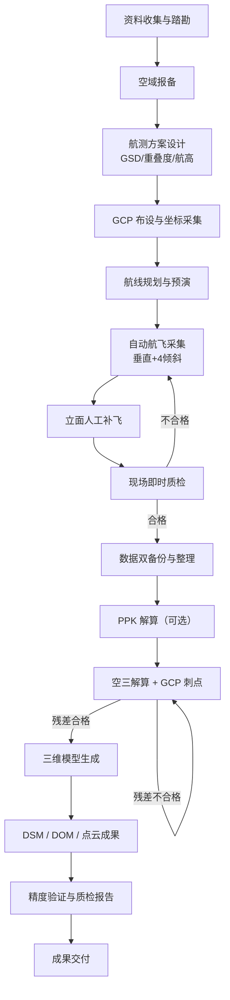

# 倾斜摄影数据采集全流程技术文档

> 版本：V1.0 ｜ 适用场景：无人机倾斜摄影实景三维建模（城市精细建模 / 大范围测绘 / 工程勘察）
>
> 核心原理：通过 **1 组垂直 + 4 组倾斜（前 / 后 / 左 / 右）多视角影像**，利用多角度高重叠影像进行空中三角测量（空三），生成带真实纹理的实景三维模型。

---

## 目录

1. [装备要求](#一装备要求)
2. [采集步骤](#二采集步骤)
3. [数据规格](#三数据规格)
4. [生成数据说明](#四生成数据说明)
5. [附录](#附录)

---

## 一、装备要求

### 1.1 无人机飞行平台

| 平台类型 | 代表机型 | 适用场景 | 关键指标要求 |
|---------|---------|---------|-------------|
| 多旋翼无人机 | 大疆 M350 RTK / M300 RTK、Mavic 3E | 城市精细建模、局部区域、复杂地形 | 载重 ≥ 1kg；抗风 ≥ 5 级；支持航线任务、断点续飞 |
| 垂直起降固定翼 | 纵横 CW-15 / 飞马 V300 | 大面积测区（≥ 10km²） | 航时长（≥ 90min）；巡航速度快；支持 PPK |
| 单兵便携多旋翼 | DJI Mavic 3E / 3T | 小范围应急、单体建筑 | 便携、快速部署 |

**选型原则**：城市高楼密集区优先多旋翼（机动灵活、便于补飞立面）；开阔大范围优先固定翼（效率高）。

### 1.2 倾斜相机系统

| 方案 | 组成 | 特点 |
|------|------|------|
| 五镜头倾斜相机（主流） | 1 个下视镜头 + 4 个倾斜镜头（前 / 后 / 左 / 右） | 一次曝光同时获取 5 张影像，效率高、纹理一致性好；如大疆 Zenmuse P1 五镜头组合、睿铂 DG4Pros |
| 单镜头 + 分时倾斜 | 单相机通过云台角度 / 多条航线分时获取 | 成本低，但效率低、易受光照变化影响，仅适合小范围 |

**相机关键参数（参考）**：

- 下视镜头焦距：35mm（等效）；倾斜镜头焦距：50mm（等效）
- 有效像素：≥ 4200 万 / 镜头
- 像元尺寸：3.9μm ~ 4.4μm
- 倾斜镜头安装角：45°（40°~50° 可调，斜片下视投影与垂直片重叠 ≥ 30%）
- 支持固定光圈 / ISO 参数锁定，避免自动曝光造成相邻影像亮度跳变

### 1.3 定位定向系统（POS）

| 组件 | 作用 | 精度要求 |
|------|------|---------|
| GNSS 接收机 | 提供相机曝光点位置（经纬度 + 高程） | 双频多星（GPS / BDS / GLONASS / Galileo） |
| RTK 实时差分 | 实时获取厘米级位置 | 固定解平面精度 1~2cm + 1ppm |
| PPK 后处理差分 | 事后联合基站数据解算高精度位置 | 平面精度 1~3cm（高楼峡谷信号差区域优于 RTK） |
| IMU 惯性测量单元 | 提供姿态角（俯仰 / 翻滚 / 航向） | 姿态精度 ≤ 0.03° |
| 地面基准站 / CORS | RTK/PPK 差分基准 | 与测区距离 ≤ 30km（PPK 可放宽） |

> **建议**：条件允许优先采用 PPK 方案。城市高楼峡谷 GNSS 遮挡严重，实时 RTK 易失锁，PPK 事后解算更稳。

### 1.4 地面控制点（GCP）设备

- 标靶：黑白棋盘格 / 十字标靶（边长 40~60cm，硬质板材或喷绘）
- RTK 测量杆 + 测量手簿（采集标靶中心三维坐标）
- 卷尺、喷漆（临时点）、红白旗（标识）
- GCP 记录表：点号、坐标、标靶照片、周边环境照片、采集时间

### 1.5 辅助设备与软件

**硬件辅助**：备用电池（≥ 3 组）、大容量高速存储卡（U3/V30 以上，≥ 128GB×N）、气象风速仪、遮光设备、移动硬盘（双备份）。

**软件**：

| 环节 | 软件 |
|------|------|
| 航线规划 / 飞行控制 | 大疆智图、DJI Pilot 2、Pix4Dcapture、UgCS、航迹大师 |
| 空三解算 | ContextCapture、大疆智图、Pix4D Mapper、Metashape |
| 三维建模 | ContextCapture、大疆智图、Pix4D Mapper、RealityCapture |
| POS/PPK 解算 | 厂家配套软件（如大疆 Terra、Trimble 等） |
| 成果质检 | 三维测图软件（EPS、SuperMap）、点云处理（CloudCompare） |

---

## 二、采集步骤

### 2.1 前期准备

1. **资料收集**：获取测区范围（CAD 红线 / KMZ-KML 边界 / 卫星底图），明确建模范围、禁飞区、限高区。
2. **现场踏勘**：确认起降点、信号遮挡、电磁干扰、机场净空、管制空域；标记高压线塔、塔吊、高大树木、玻璃幕墙等隐患。
3. **空域报备**：国内无人机航测须向民航 / 公安完成空域申请与备案（合法合规前提）。
4. **设备检查**：电池、云台、镜头清洁、罗盘校准、RTK/PPK 状态、存储卡容量、避障功能自检。

### 2.2 航线规划设计

1. **导入测区边界**至航测软件，选择「倾斜摄影任务」，自动生成：垂直航线 + 4 方向倾斜航线。
2. **确定航摄参数**（核心参数见[第三节数据规格](#三数据规格)）：
   - 根据目标 GSD 反算航高：`航高 ≈ GSD × 焦距 ÷ 像元尺寸`
   - 航向重叠 **80%~85%**，旁向重叠 **70%~80%**（倾斜摄影重叠度要求高于正射）
   - 倾斜角 45°，下视 90°垂直
3. **边界外扩**：测区边界外扩 ≥ 1 条航线（通常外扩 1 个航高距离），防止模型边缘拉花、空洞。
4. **架次划分**：按障碍物 / 地形拆分布线；高大建筑区域增加**立面加密航线**（环绕或贴近立面）。
5. **安全设置**：航线高度高于测区内最高障碍物 ≥ 30m；设置返航点、低电量保护、断点续飞。
6. **GCP 布设方案**：
   - 有高精度 POS（RTK/PPK）：每平方公里布设 3~5 个 GCP（兼做精度检核），均匀分布测区四周与中部；
   - 无差分定位：按 100~200m 间隔加密布设；
   - 标靶放置于硬质地面、屋顶等稳定处，**必须能被多个角度镜头同时拍到**（避免被遮挡）。
7. **航线预演**：模拟飞行检查是否穿越禁飞区、高压线、高楼；人工修正危险航线。

### 2.3 外业数据采集

1. **起飞前检查**：罗盘校准、RTK 固定解确认；锁定相机参数（固定光圈 / ISO / 快门），禁用自动曝光。
2. **自动航飞**：按规划航线自动拍摄，五镜头同步曝光（1 次触发 = 5 张影像）；操作员实时监控 GPS 信号、电量、云台状态、有无丢片。
3. **人工补飞（城区建模必做）**：
   - 建筑立面、狭窄街巷、桥下、大树遮挡、背阴面 → **环绕补飞**，近距离斜拍立面；
   - 水面、玻璃幕墙反光过曝区域 → 补拍或调整拍摄时段。
4. **GCP 坐标采集**：RTK 采集标靶中心三维坐标（平面 + 高程），现场拍照留存标靶特写 + 周边环境，便于内业刺点。
5. **检查点（可选）**：额外布设 CP（检查点）用于模型精度验证，不参与空三刺点，与控制点严格区分。

### 2.4 现场即时质检（当场完成，避免返工）

| 检查项 | 标准 | 处置 |
|--------|------|------|
| 影像完整性 | 照片数量 = 触发次数 × 镜头数，无丢片 | 缺片立即补飞 |
| 影像清晰度 | 无模糊、无重影 | 模糊区域重飞 |
| 曝光质量 | 无过曝 / 欠曝，亮度连续 | 调整参数重飞 |
| POS 数据 | 曝光点位置姿态完整、无异常跳变 | 异常航线段重飞 |
| 重叠度抽检 | 相邻照片航向 / 旁向重叠达标 | 不达标加密航线 |
| 覆盖率 | 测区全覆盖，无空洞 | 补飞空洞区域 |

> 发现缺片、模糊、空洞，**必须当场补飞**，不要等内业处理时才发现返工。

### 2.5 内业预处理

1. **数据双备份**：影像 + POS 数据（GPS+IMU）双份存储（本机 + 移动硬盘）。
2. **数据整理**：按架次分类命名（`项目_架次_日期`），剔除废片（模糊、黑屏、过曝）。
3. **PPK 解算（如采用）**：导入基站观测数据，解算每张照片的高精度位置姿态。
4. **空三解算**：导入建模软件，刺 GCP（每个控制点在 ≥ 3 张影像上刺点），进行空中三角测量，检查空三残差（平面中误差 ≤ 1 倍 GSD，高程中误差 ≤ 2 倍 GSD 为合格线）。
5. **三维建模**：空三通过后生成三维模型（OSGB 等格式），再进行后续 DOM / DSM 等成果生产。

---

## 三、数据规格

### 3.1 航摄参数规格（核心）

| 参数 | 规格 | 说明 |
|------|------|------|
| 地面分辨率 GSD | 城市精细建模 **1.5~3cm**；大面积测绘 **3~5cm** | 建模细节与数据量权衡；1:500 测图要求 GSD ≤ 2.5cm |
| 航向重叠 | **80%~85%** | 倾斜摄影最低 80% |
| 旁向重叠 | **70%~80%** | 保证侧面纹理完整 |
| 倾斜镜头夹角 | **45°**（40°~50°） | 斜片与垂直片投影重叠 ≥ 30% |
| 航线航高 | 由 GSD 反算：`航高 ≈ GSD × 焦距 ÷ 像元尺寸` | 示例：GSD 2cm、焦距 35mm、像元 4.4μm → 航高约 159m |
| 最高障碍物净空 | ≥ 30m | 安全冗余 |

**GSD 计算示例**：像元尺寸 4.4μm、焦距 35mm、目标 GSD 2cm：
`航高 = 0.02m × 0.035m ÷ 0.0000044m ≈ 159m`

### 3.2 影像数据规格

| 项目 | 规格 |
|------|------|
| 影像格式 | JPG（高画质）或 RAW（TIFF 无损） |
| 单张分辨率 | ≥ 4200 万像素（7952×5304 级） |
| 色彩空间 | sRGB / Adobe RGB，8bit（RAW 12bit） |
| 曝光参数 | 固定光圈 / ISO，光圈 f/4~f/8，ISO ≤ 400（白天），快门 ≥ 1/500s 防抖动 |
| 时间标记 | 每张影像嵌入精确曝光时间（与 POS 对齐） |
| 单张体积 | 高分辨率 JPG 约 15~40MB；RAW 约 50~80MB |

### 3.3 定位与控制点数据规格

**POS 记录字段**（每张影像对应一条）：

```
影像编号 | 经度(°) | 纬度(°) | 高程(m) | 俯仰角(°) | 翻滚角(°) | 航向角(°) | 曝光时间
```

**GCP 记录字段**：

```
点号 | X(m) | Y(m) | Z(m) | 坐标系 | 采集时间 | 刺点影像数(≥3) | 标靶照片编号
```

**坐标系约定**：优先使用 CGCS2000 + 1985 国家高程基准；城市项目常使用当地城建坐标系 / 独立坐标系，须在 POS、GCP、成果中全程统一并记录坐标系参数。

### 3.4 数据量与存储估算

| 场景 | 照片量（五镜头） | 原始影像体积 | 生成模型体积（OSGB） |
|------|-----------------|-------------|---------------------|
| 单栋建筑（0.01km²） | 500~1500 张 | 15~50GB | 5~20GB |
| 小区 / 园区（0.1km²） | 3000~8000 张 | 100~300GB | 30~100GB |
| 城区 1km²（GSD 2cm） | 1.5万~3万张 | 500GB~1TB | 150~500GB |

> 估算经验公式：照片数 ≈ 测区面积 ÷（旁向间距 × 航向间距）÷ 每张覆盖比例；最终以航线规划软件输出为准。**存储规划按原始影像体积 ×2 预留**（双备份 + 中间成果）。

---

## 四、生成数据说明

### 4.1 空三加密成果（AT）

- **内容**：每张影像的外方位元素（位置 + 姿态）、相机内参数（焦距 / 畸变）、控制点残差报告、连接点（Tie Points）密集点云。
- **作用**：三维建模的数学基础；空三质量直接决定模型精度。
- **关键指标**：平面中误差 ≤ 1 倍 GSD；高程中误差 ≤ 2 倍 GSD；控制点残差可视化检查。

### 4.2 实景三维模型（真三维 / 带纹理）

| 格式 | 说明 | 适用 |
|------|------|------|
| **OSGB** | 倾斜摄影建模事实标准，LOD 分级瓦片结构 | Cesium、SuperMap、EPS、主流 GIS 平台 |
| OBJ / FBX | 单体化模型、可编辑 | 3ds Max、Blender、UE/Unity |
| 3D Tiles / S3M | 网络化流式加载 | WebGIS 大场景发布 |
| STL / PLY | 网格数据交换 | 3D 打印、点云处理 |

**成果属性**：真实纹理、三角网结构、LOD 多级细节（近景清晰、远景简化）、带地理坐标可直接叠加 GIS。

### 4.3 数字表面模型（DSM）

- 包含地表以上所有地物（建筑、树木）的表面高程模型。
- 格式：GeoTIFF（单波段高程栅格），分辨率与 GSD 一致或为其整数倍。
- 用途：淹没分析、土方量计算、航线规划、通视分析。

### 4.4 正射影像（DOM）

- 将倾斜摄影成果垂直投影纠正后的影像图，无透视变形、坐标准确。
- 格式：GeoTIFF（多波段，含坐标信息），分辨率 = GSD。
- 用途：二维底图、地物判读、变更检测、与模型叠加分析。
- 注意：倾斜摄影 DOM 对高楼底部遮挡区域可能存在拉花，需结合补飞影像修正。

### 4.5 点云成果

- **密集匹配点云**：由影像匹配生成，含 XYZ + RGB。
- 格式：LAS / LAZ / XYZ / PLY。
- 用途：高精度测量、断面提取、去噪建模、考古 / 林业 / 电力巡检分析。
- 密度：随 GSD 提高而加密（GSD 2cm 时点密度可达数百点/m²）。

### 4.6 精度验证与质量报告

| 精度项 | 验收参考标准 |
|--------|-------------|
| 平面中误差（检查点） | ≤ 1.5~2 倍 GSD（如 GSD 2cm → ≤ 3~4cm） |
| 高程中误差（检查点） | ≤ 2~3 倍 GSD |
| 模型表面完整性 | 无大面积破洞、拉花、悬浮物 |
| 纹理质量 | 无重影、无过曝欠曝、色彩连续 |
| 坐标系统一性 | 与测区约定坐标系一致，无偏移 |

> 生成《空三精度报告》《模型质检报告》，包含检查点统计表、误差分布图、成果清单，作为交付验收依据。

---

## 附录

### A. 全流程总览（流程图）



### B. 外业现场检查清单

- [ ] 空域批文 / 报备回执
- [ ] 无人机、电池（≥3 组）、云台、镜头
- [ ] 存储卡容量充足、格式化
- [ ] RTK/PPK 状态、基准站架设
- [ ] 罗盘 / IMU 校准
- [ ] GCP 标靶、记录表、RTK 手簿
- [ ] 气象确认（风力 ≤ 5 级、无雨无雾）
- [ ] 航线导入并预演通过
- [ ] 返航点、低电量保护、断点续飞设置

### C. 常见问题与避坑要点

| 问题 | 原因 | 对策 |
|------|------|------|
| 模型扭曲 / 破洞 | 重叠度不足、立面遮挡、水面玻璃反光 | 提高重叠度；立面环绕补飞；调整拍摄时段 |
| 影像亮度跳变 | 自动曝光 | 固定光圈 / ISO / 快门 |
| 边缘拉花 | 测区外扩不足 | 边界外扩 ≥ 1 条航线 |
| 空三残差超标 | GCP 刺点不准、POS 异常 | 每个 GCP 刺 ≥ 3 张像片；检查 POS 跳变 |
| 高楼峡谷信号差 | GNSS 遮挡 | 优先 PPK；增加 GCP |
| 模型悬浮 / 空洞 | 运动物体（车、人）干扰 | 时段选择车流少时；后期人工修补 |

---

*文档结束。参数为行业通用参考值，具体项目以航测规范（如《低空数字航空摄影测量内业规范》《实景三维中国建设技术大纲》）和软件输出为准。*
